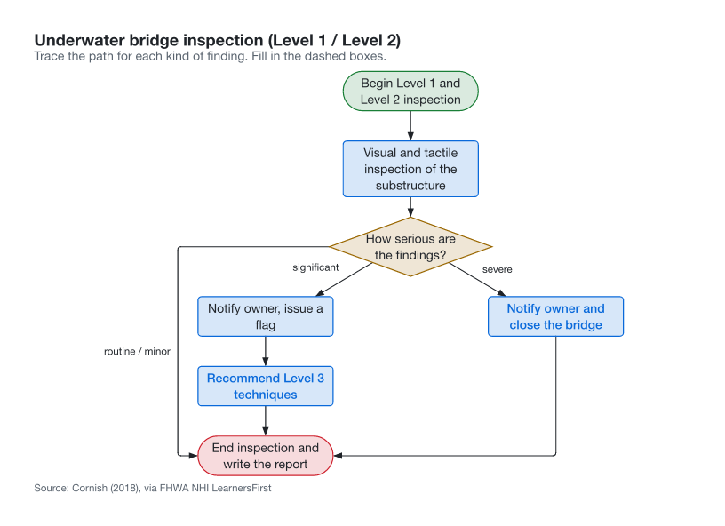
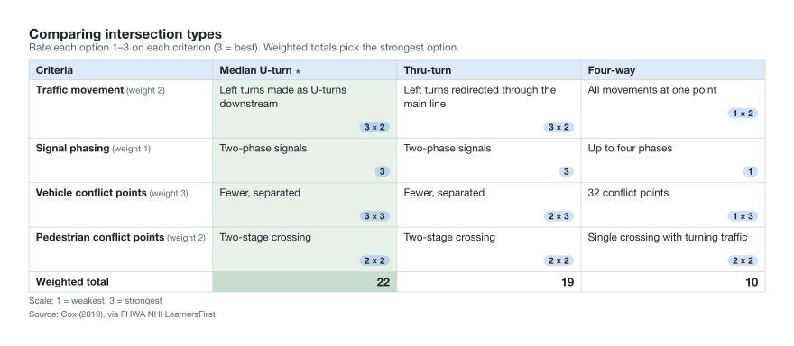
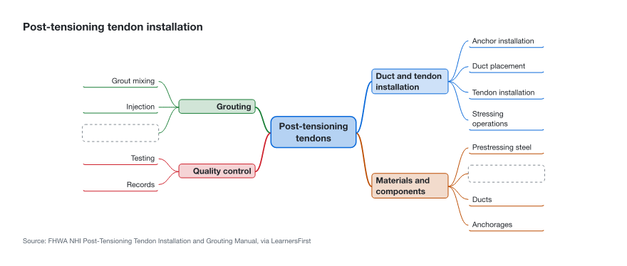
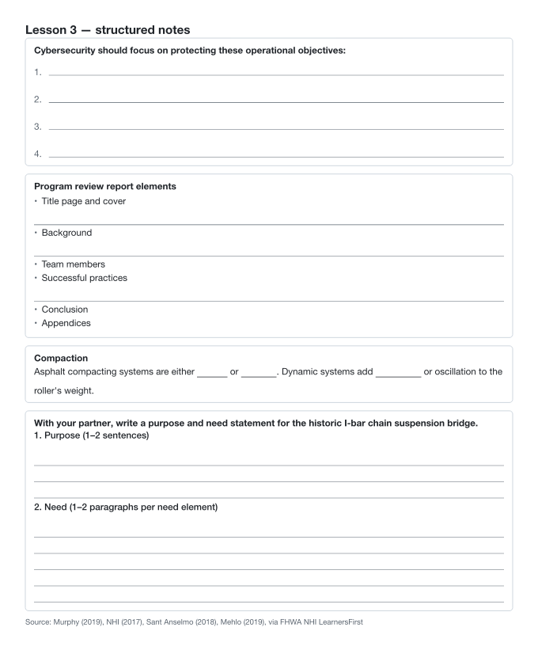

# learning-organizers

Build and edit **graphic organizers and learning tools** in Claude Code: T-charts, decision
matrices, flow charts, mind maps, concept maps, K-W-L charts, anticipation guides, action
plans, structured notes, assessment checklists, rubrics, self-questioning sheets and
lesson kits.

Each organizer is **one YAML spec**. Claude writes it, you ask for changes ("add a cost
criterion", "blank out the grout node", "A4 please"), and Typst redraws it as:

- a **printable PDF**, in two versions from the same spec: the **answer key** and the
  **learner copy**, with writing space where the answers were;
- a **PNG** to share;
- a **live picture in your terminal** when
  [cc-intelligent-ui](https://github.com/razorback16/cc-intelligent-ui) is installed. It
  draws the organizer in your terminal theme's colours, inside the conversation.

The organizer types and their teaching guidance come from the Federal Highway
Administration's National Highway Institute
[*LearnersFirst* instructor handbook](https://fhwaapps.fhwa.dot.gov/nhit/LearnersFirst/graphic-organizers.htm).
The worked examples recreate its figures.

<table>
  <tr>
    <td width="50%"></td>
    <td width="50%"></td>
  </tr>
  <tr>
    <td></td>
    <td></td>
  </tr>
</table>

## Install

```
brew install typst          # Typst 0.15
/plugin install learning-organizers --marketplace marsman-io/claude-marketplace
```

Optional, for pictures in the terminal (kitty, Ghostty, iTerm2 and others; see its README):

```
/plugin install cc-intelligent-ui --marketplace razorback16/cc-intelligent-ui
```

When cc-intelligent-ui is installed, renders use the CeTZ and fletcher packages it
bundles, so they work offline. Without it, Typst downloads `cetz:0.5.2` and
`fletcher:0.5.8` once.

## Skills

| Skill | Does | Fires on |
|---|---|---|
| `graphic-organizer` | Chooses the organizer for the learner's task, writes the spec from a worked example, checks and renders it, shows it inline, and edits it on request | "make a T-chart comparing…", "decision matrix for…", "concept map of…", "rubric for…", "learner version", "add a branch" |
| `lesson-kit` | Turns a learning outcome into a before/during/after set: one handout spec, one page per tool in the PDF | "make handouts for this lesson", "before/during/after activities for…" |

## The CLI

`scripts/organizer.py` is stdlib-only Python. The skills drive it, and you can run it
yourself:

```
organizer.py types                          # the 13 types, one line each
organizer.py new concept-map organizers/pt.yaml
organizer.py check organizers/pt.yaml       # exit 1 with every problem listed; layout warnings
organizer.py render organizers/pt.yaml      # pt.key.pdf pt.learner.pdf pt.key.png pt.learner.png
organizer.py render pt.yaml --format svg --version learner --dark --paper a4
organizer.py inline organizers/pt.yaml      # the ```typst block cc-intelligent-ui draws
organizer.py doctor
```

For a concept map, flow chart or mind map, `check` also lays out both versions. When the
drawing still puts one thing on top of another (a label over a label or a box, a line
through a box or through another line's label), it prints a `warning (key, learner): …`
line naming both (and the versions that draw it). It still exits 0, because the spec is valid and renders, but the picture
needs shorter labels or fewer links at that node. `render` and `inline` print the same
warnings on stderr and draw anyway. A layout `check` cannot read is an error (exit 2), not
a pass.

How the inline picture works: `inline` prints a three-line Typst block that imports
`typst/organizers.typ` and points at the spec. cc-intelligent-ui compiles live
`typst` blocks with its theme in scope, and the library draws in those colours. The
library is copied to a content-addressed path under `~/.cache/learning-organizers/`, so
pictures already in a transcript keep drawing after a plugin update. A revision comment
follows the spec's hash, so an edited spec redraws instead of reusing the cached picture.

## Layout

```
.claude-plugin/plugin.json
skills/graphic-organizer/SKILL.md
skills/lesson-kit/SKILL.md
references/spec.md        # every field of every type
references/teaching.md    # purpose, how to run, failure mode (FHWA LearnersFirst)
typst/organizers.typ      # the renderers, validator and layout (CeTZ + fletcher)
typst/standalone.typ      # page wrapper for PDF / PNG / SVG
scripts/organizer.py      # CLI
examples/*.yaml           # one worked spec per type
tests/selftest.py         # + tests/bad/*.yaml
```

## Tests

```
python3 tests/selftest.py
```

The self-test checks and renders every example in both versions. From each render's
metadata, it confirms that no answer marked as a blank reaches the learner copy, and that
an unmarked template shows the learner no answers at all. It also confirms:

- each bad spec in `tests/bad/` is refused with its named problem;
- in every concept map, flow chart and mind map example and every spec in `tests/layout/`,
  in both versions, the render records one box per node and drawn label and one path per
  edge, and no label or box is drawn over another, no line runs through a box other than
  its ends, and no line runs through another line's label;
- the deliberately dense `tests/layout/dense-decision.yaml` draws the collision its first
  line names, and `check`, `render` and `inline` all warn about it;
- the overlap check itself reports two boxes forced onto each other, and treats missing
  records or boxes without area as an error, not a clean layout;
- an edited spec gets a new inline revision;
- when cc-intelligent-ui is installed, its own `md.typ` renderer draws the inline block in
  dark and light.

Eight mutations each make it fail: hiding disabled, fill-in answers shown, a validator
check removed, a fixed inline revision, geometry records zeroed, labels forced to their
edge's midpoint, cross-links drawn straight with no rerouting, and the layout warning
dropped from `check`.

## Limits

- Layout is automatic. Concept maps, flow charts and mind maps are spread out until no
  label or box is drawn over another, and no line runs through a box or another line's
  label. Lines may still cross other lines. When a dense graph cannot be drawn cleanly,
  `check` warns and names the pair. Set `level` on concepts to steer a concept map.
- The overlap check measures the drawn geometry with 1 pt of tolerance, so a line that
  grazes a box by less is not reported.
- Spec strings are plain text, with no Markdown inside an organizer.
- Background sessions cannot draw terminal pictures. The PNG and PDF still render.
- macOS is tested. Linux should work, with a different default font.

## Attribution

The organizer types, guidance and example content are adapted from FHWA NHI
*LearnersFirst*, a U.S. federal government publication. Example figures are credited to
the course participants the handbook cites. This plugin is not affiliated with or endorsed
by FHWA. The inline drawing builds on cc-intelligent-ui by razorback16 (MIT).
